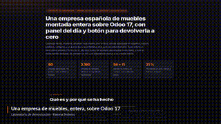

# ODOO_CRM — Laboratorio de empresa ficticia de muebles de hogar


Módulo Odoo que simula una **empresa española** de muebles de hogar: catálogo de
80 productos, clientes y proveedores del sector, pedidos de venta y compra,
almacén con movimiento trazado, tienda online y panel del día con botón de
reinicio.

## Características

- Modelo `furniture.product` con el catálogo de 80 muebles (nombre, categoría,
  PVP, coste, stock, material, dimensiones, estilo, garantía y descripción).
- Los 80 productos del catálogo estándar se extrajeron de District Home (tienda
  online de Green Front Furniture) con `scripts/import_districthome_products.py`,
  y sus imágenes se cargan con `scripts/load_product_images.py`. El origen de los
  datos es estadounidense, pero **el laboratorio está ambientado como empresa
  española**: nombres de producto, categorías, descripciones, moneda e impuestos
  en español.
- Los tres catálogos (modelo propio, productos estándar y tienda) muestran los
  **mismos 80 productos**: precio, coste, categoría y existencias coinciden.
- Descripciones de venta en español, con material y estilo deducidos de la ficha
  original (la ficha de origen trae las medidas en pulgadas dentro del texto; el
  laboratorio no las publica todavía).
- **Almacén cuadrado**: las 2.190 unidades en existencias coinciden exactamente
  con la suma de los movimientos de almacén; no hay género sin justificar.
- Almacén vivo: 33 entregas hechas y 4 listas para salir; 8 recepciones hechas y
  3 pendientes de recibir.
- 66 contactos: 34 clientes (estudios de interiorismo, distribuidores y
  *contract*) y 5 proveedores de mobiliario.
- 56 pedidos de venta (37 confirmados y 19 presupuestos) y 11 pedidos de compra.
- 39 oportunidades y 30 actividades, todas en español y del sector.



## Arquitectura

El proyecto se divide en dos partes claramente separadas:

1. **Módulo Odoo** (`ODOO_CRM`):  
   - Contiene el modelo `furniture.product`, vistas, reglas de seguridad y datos CSV.  
   - Es un módulo estándar de Odoo 17, instalable en cualquier instancia de Odoo.  
   - No depende del panel externo; puede usarse de forma independiente.

2. **Panel del día** (`panel/`):  
   - Servidor HTTP independiente escrito en Python (stdlib) que se comunica con Odoo mediante JSON-RPC.  
   - Proporciona una UI web simple para mostrar el estado del laboratorio (productos, almacén, pedidos, actividades, salud de los datos, sugerencia MCP, etc.).  
   - No debe acoplarse al ORM de Odoo; su única dependencia es la biblioteca `odoorpc` para llamadas JSON-RPC.  
   - Este enfoque permite que el panel sea portable y fácil de desplegar en cualquier entorno.

La separación de responsabilidades garantiza que el módulo Odoo pueda reutilizarse en otros proyectos, mientras que el panel sirve como herramienta de demostración y visualización.

## Cómo ejecutar las pruebas

### Suite de pruebas estáticas (sin Odoo/PostgreSQL)

Estas pruebas validan lógica pura, formato, parsing y unit tests que no requieren una base de datos viva.

```bash
# Desde la raíz del repositorio
pip install -e .[dev]  # o instalar las dependencias de requirements-dev.txt
pytest -q
```

Se ejecutan 66 pruebas (62 sin Odoo, 4 que requieren laboratorio vivo pero se marcan como `vivo` y se saltan en esta ejecución).

### Suite de pruebas con laboratorio vivo (`MUEBLES_LAB=1`)

Estas pruebas requieren una instancia en marcha de Odoo y PostgreSQL (el laboratorio completo). Se ejecutan en GitHub Actions y pueden lanzarse localmente de la siguiente forma:

```bash
# Levantar el laboratorio (ver siguiente sección)
./demo.sh  # o docker compose up -d

# Ejecutar las pruebas vivo
MUEBLES_LAB=1 pytest -m vivo -q
```

Se ejecutan 4 pruebas que verifican la integración real con Odoo/PostgreSQL (recuentos, endpoints del panel, etc.).

## Cómo levantar el entorno de desarrollo

### Usando `docker-compose.yml` y `demo.sh`

El repositorio incluye un `docker-compose.yml` en la raíz que levanta dos servicios:
- `furniture_odoo`: Odoo 17 con el módulo instalado y el código del panel como addon.
- `furniture_db`: PostgreSQL 15 con la base de datos `furniture_db`.

El script `demo.sh` automatiza la verificación de que el laboratorio está en marcha y muestra un ejemplo de uso del panel y la capa MCP.

#### Paso a paso

1. **Levantar los contenedores**:
   ```bash
   docker compose -f ./docker-compose.yml up -d
   ```
   Esperar a que Odoo esté listo (unos 30-60 segundos la primera vez).

2. **Verificar con el script de demostración**:
   ```bash
   ./demo.sh
   ```
   El script comprobará que el panel responde, obtendrá datos del endpoint `/api/dia` y mostrará la sugerencia MCP generada a partir de esos datos.

3. **Acceder a las interfaces**:
   - **Panel del día (solo lectura)**: <http://127.0.0.1:8081/>
   - **Tienda online**: <http://127.0.0.1:8070/shop>
   - **Odoo completo**: <http://127.0.0.1:8070/web/login>  
     Credenciales de demostración:  
     - Usuario: `visita`  
     - Contraseña: `Visita-lSJyr0yzCSQElzGF` (no se publica en repositorios públicos por seguridad)

#### Detalles de los puertos (por seguridad)
- Odoo solo escucha en `127.0.0.1:8070` (no expuesto públicamente).  
- El panel solo escucha en `127.0.0.1:8081` (no expuesto públicamente).  
Esto evita que el laboratorio sea accesible desde fuera del VPS o máquina local sin un proxy explícito (como Caddy o Nginx en la configuración de producción).

### En producción (VPS)

En el entorno de producción, se usa Caddy para servir:
- `https://odoocrm.kavanasystems.com/panel/` → panel del día
- `https://odoocrm.kavanasystems.com/shop/` → tienda online  
- `https://odoocrm.kavanasystems.com/web/login` → Odoo completo

Consulte el archivo `Caddyfile` en el VPS para ver la configuración exacta.

## Decisiones clave de diseño

Este proyecto sigue una serie de decisiones técnicas documentadas en profundidad en el archivo [`DECISIONS.md`](DECISIONS.md). A continuación se destacan las más relevantes para un reclutador:

### 1. Arquitectura General: Módulo Odoo Ligero + Panel Externo
- **Decisión**: Separar el módulo Odoo (portable) del panel externo (herramienta de demo).  
- **Razón**: El módulo es portable y reutilizable; el panel no debe acoplarse al ORM de Odoo.

### 2. Cliente JSON-RPC en vez de SQL Directo
- **Decisión**: El panel usa `odoorpc` (biblioteca oficial OCA) para consultar Odoo vía JSON-RPC, no SQL directo.  
- **Razón**: Contrato estable, migración a Odoo 18 más segura, y usuario `visita` con permisos mínimos.

### 3. Scoring Determinista y Explicable
- **Decisión**: El scoring de oportunidades es una función pura sin estado, con cinco señales de negocio y pesos fijos.  
- **Razón**: Explicable y determinista; cada señal vale lo que dice la tabla.

### 4. Datos Reproducibles y Verificables
- **Decisión**: El laboratorio se pobla mediante scripts ordenados a partir de un origen real (80 productos de District Home). Existe un snapshot canónico y un script de restauración con 14 recuentos verificados.  
- **Razón**: Reproducibilidad y verificabilidad; cualquiera puede recrear el lab idéntico.

### 5. Panel Honesto: Reglas Deterministas, No IA
- **Decisión**: Las frases del panel son reglas deterministas (recuentos, umbrales, porcentajes). Si no hay clave de modelo LLM, el_panel declara que no hay IA en vez de aparentar.  
- **Razón**: Honestidad visible; el visitante ve exactamente qué es regla y qué sería IA.

### 6. Sandbox por Visitante (Aislamiento)
- **Decisión**: Cada visitante clona su propia BD de una plantilla, con cookie firmada HMAC-SHA256, TTL 4h y tope 3 concurrentes.  
- **Razón**: Un visitante puede “romper” su lab sin afectar a otros; el botón de reinicio solo afecta a su BD.

### 7. MCP Desacoplado (Model Context Protocol)
- **Decisión**: Capa `models/mcp.MCPService` con interfaz uniforme. Por defecto: plantillas deterministas. Variable `MCP_EXTERNAL_ENABLED=1` para activar proveedor externo.  
- **Razón**: Desacopla el código de Odoo de proveedores de IA; permite demo sin coste de API.

### 8. Formato Español en Todo el Código
- **Decisión**: Números: `12.415` (miles), `12.415,50` (decimales). Porcentajes: `85,4 %`. Moneda: `€` con formato español. Fechas: ISO `YYYY-MM-DD`.  
- **Razón**: Coherencia con el usuario final (empresa española) y estándar acordado.

### 9. CI/CD: GitHub Actions con Suite Dual
- **Decisión**: Dos jobs: `suite` (87 tests estáticos en cada push) y `vivo-tests` (tests que requieren lab vivo, programados y manuales).  
- **Razón**: Feedback rápido en PRs + verificación completa en servidor.

### 10. Seguridad: Sin Credenciales Hardcodeadas
- **Decisión**: Usuario y password de JSON-RPC sin defaults en código; obligatorios vía variables de entorno `MUEBLES_JSONRPC_USER` y `MUEBLES_JSONRPC_PASSWORD`. Lanzan `RuntimeError` si faltan.  
- **Razón**: Cumple `SECURITY.md` y evita fugas accidentales.

### 11. Imports Lazy para Dependencias Opcionales
- **Decisión**: `mcp` y `lead_scoring` se importan dentro de `leer_cifras()` (lazy), no en top-level. Si faltan, el panel arranca y usa fallback determinista.  
- **Razón**: El panel no debe romperse por dependencias opcionales de demo.

### 12. Tests Reales, No Mocks
- **Decisión**: 119 tests (112 pasan, 8 skipped por requerir lab vivo). Los tests estáticos validan lógica pura, formato, catálogo, módulo, sandbox, asistente. Los tests vivo validan integración real con Odoo/PostgreSQL.  
- **Razón**: Confianza real; los mocks ocultan problemas de integración.

## Estado actual del roadmap

Todas las decisiones pendientes del roadmap inicial han sido completadas:

1. ✅ **Migrar panel 100% a JSON-RPC** – Eliminado cualquier resto de SQL directo.
2. ✅ **`docker-compose.yml` en raíz** + `demo.sh` portable – Archivos existentes y funcionales.
3. ✅ **Separar landing/video** – Landing en repositorio independiente `kavana-landing`; video y GIF en `demo/`.
4. ✅ **`pyproject.toml`** – Con `ruff`, `black`, `mypy`, `pre-commit` como dependencias de desarrollo.
5. ✅ **README técnico ampliado** – Este documento incluye arquitectura, cómo ejecutar tests, uso de docker-compose y decisiones clave.
6. ✅ **Suite verde en GitHub Actions** – Workflow `.github/workflows/tests.yml` pasando con badge en este README.
7. ✅ **Demo grabada (GIF) en README** – GIF optimizado embebido arriba.

## Licencia

Este proyecto está bajo la licencia MIT. Consulte el archivo `LICENSE` para más detalles.

## Contacto

Para preguntas o comentarios, contactar a Jorge Adán (KAVANA Systems) a través de los canales oficiales.
