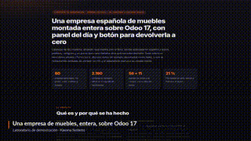

# ODOO_CRM — laboratorio de una empresa de muebles sobre Odoo 20


Laboratorio para estudiar Odoo por dentro: una empresa ficticia española de
muebles de hogar (Muebles del Hogar S.L.) con CRM, ventas, compras, almacén y
tienda online, un módulo propio de personalización y un panel externo que lee
Odoo por su API. **Es un entorno de demostración, no una implantación
productiva.** Demo pública: <https://odoocrm.kavanasystems.com>.



## Qué hay dentro

| Pieza | Qué hace | Dónde |
|---|---|---|
| Ficha de mobiliario | Amplía el producto **nativo** (`product.template`) con material, medidas, estilo y garantía. Precio, coste, existencias y categoría son los de Odoo: no hay catálogo paralelo. | `models/product_template.py` |
| Scoring comercial | Hereda `crm.lead` con cinco señales y un score determinista de 0 a 100. Todos los campos calculados declaran `@api.depends`; "contacto reciente" cuenta correos, mensajes al cliente y actividades **hechas**, no tareas planificadas ni notas internas. | `models/crm_lead_scoring.py`, `models/lead_scoring.py` |
| Seguridad Odoo 20 | Grupo «Panel del día: solo lectura» con permisos `r` en el formato `ir.access` de Odoo 20 y claves API de 90 días como máximo. | `security/` |
| Migración de datos | `migrations/20.0.2.0.0/`: pasa los datos del catálogo paralelo de la v1 a los productos nativos, guarda una copia de la tabla antigua y no duplica la categoría raíz. | `migrations/` |
| Panel del día | Servidor HTTP (librería estándar) que resume el día en lenguaje de negocio. Lee **solo** por la API JSON-2 de Odoo con el usuario de integración: ni SQL ni contraseñas. | `panel/panel_muebles.py`, `panel/odoo_client.py` |
| Empresa viva | Simulador por tramos (3 al día, L-V, y el sábado): leads, correos de clientes, llamadas, presupuestos, entregas, facturas, cobros, compras y recepciones, siempre con los métodos de negocio de Odoo y comprobando la coherencia al final. Reproducible, idempotente y sin correos reales posibles. Ver [ADR-003](docs/adr/ADR-003-empresa-viva.md). | `models/simulador_empresa.py`, `panel/jornada.sh` |
| Escaparate de solo lectura | El visitante de la demo pública ve toda la empresa (también facturas y cobros) y no puede crear, modificar ni borrar nada. Un único punto en el sistema de permisos de Odoo 20 (`_access_domain`) lo cierra en todos los modelos, sin listarlos; la interfaz abre los formularios en lectura. | `models/escaparate.py` |
| Sugerencias comerciales | Plantillas deterministas que proponen la siguiente acción según el score. Es una capa preparada para enchufar un modelo de IA; **no es un servidor MCP** (el nombre `mcp.py` es histórico). | `models/mcp.py` |

## Cómo se comprueba

Nada de esto se da por bueno porque compile: el workflow
[`odoo`](.github/workflows/odoo.yml) levanta la **imagen oficial de Odoo 20**
con PostgreSQL 17 en cada PR y:

1. **Instala el módulo en una base vacía** y ejecuta sus pruebas `TransactionCase`
   (`tests/`): ficha nativa y stock único, recálculo del score al cambiar una
   señal, qué cuenta como contacto real, permisos del usuario de integración y
   vida de su clave API.
2. **Prueba el panel de extremo a extremo**: crea el usuario de integración, su
   clave y datos de negocio conocidos, arranca Odoo, el panel lee todas sus
   cifras por la API y se comparan con lo que cuenta el ORM. Después intenta
   escribir con la misma clave y Odoo tiene que responder 403.
3. **Ensaya la actualización desde la v1** (commit `5ec6960`, con el catálogo
   paralelo): instala la v1, siembra datos como en la demo pública, actualiza a
   la v2 y verifica que las 80 fichas pasan a los productos nativos, que la copia
   de la tabla antigua existe y que no hay categorías duplicadas.

El workflow [`tests`](.github/workflows/tests.yml) pasa el linter oficial de la
OCA y la suite sin Odoo (`tests_estaticos/`: catálogo, lógica del panel,
cliente de la API con un Odoo simulado, asistente, sandbox).

```bash
pip install -r requirements-dev.txt
pytest -q                       # suite sin Odoo
python scripts/lint_oca.py      # linter OCA del módulo
```

## Levantarlo en local

```bash
docker compose up -d            # Odoo 20 + PostgreSQL 17, solo en 127.0.0.1
```

> **Si ya tienes un laboratorio creado con PostgreSQL 15** (la v1 del
> compose), no lo levantes tal cual: PostgreSQL 17 no abre un volumen de la 15
> y la base no arrancará. Antes, haz una copia (`pg_dumpall`) y restáurala en
> un volumen nuevo, o fija `POSTGRES_IMAGE=postgres:15` en `.env` mientras
> tanto, sabiendo que Odoo 20 necesita la 16 o superior para crear bases o
> grupos nuevos.

1. Entra en <http://127.0.0.1:8070>, crea la base `furniture_db` e instala
   **Mobiliario del Hogar (laboratorio ODOO_CRM)**.
2. Siembra el laboratorio (catálogo, stock, clientes y pedidos):
   `docker exec -i furniture_odoo odoo shell -d furniture_db --no-http < scripts/create_lab_data.py`
3. Crea un usuario técnico (por ejemplo `panel_integracion`) con los grupos
   *Usuario interno* y *Panel del día: solo lectura*, genera una clave API con
   alcance `rpc` desde sus preferencias y guárdala en `.env` como
   `MUEBLES_ODOO_API_KEY` (ver [`.env.example`](.env.example)).
4. `docker compose --profile panel up -d panel` y abre <http://127.0.0.1:8081>.

## Desplegar la v2 en la demo

`sudo scripts/despliegue/desplegar_v2.sh comprobar` dice, sin tocar nada, si se
puede; `desplegar` hace copia de todas las bases, pasa PostgreSQL de la 15 a la
17 en un volumen nuevo, actualiza el módulo, crea el usuario de integración y la
nueva instantánea; `volver_atras` devuelve la v1 sobre el volumen original. El
job `ensayo-despliegue` del CI lo ejecuta entero sobre una copia de la demo.

## Caso de negocio

[`docs/caso-de-negocio.md`](docs/caso-de-negocio.md): el proceso de la oportunidad a la
entrega, con roles, excepciones, criterios de aceptación e indicadores.

## Decisiones

- [ADR-002](docs/adr/ADR-002-modelo-nativo-y-api.md): por qué la v2 amplía
  `product.template`, lee por la API JSON-2 y migra los datos así.
- [`DECISIONS.md`](DECISIONS.md): el resto de decisiones del laboratorio.
- [`SECURITY.md`](SECURITY.md): credenciales, usuario de integración y exposición.

## Lo que este laboratorio todavía no demuestra

Para que nadie lo confunda con una implantación real:

- El ciclo que simula es el feliz: factura de lo entregado y cobro completo.
  No hay pagos parciales, facturas rectificativas, devoluciones, entregas
  parciales ni cancelaciones con stock reservado.
- Un solo almacén y una sola empresa; sin unidades de medida alternativas,
  lotes ni valoración de inventario.
- No hay migración desde otro sistema (Excel, Holded, otro ERP) con datos
  sucios: la migración que hay es entre versiones del propio módulo.
- Los campos del CRM usan el prefijo `x_`, que en Odoo se reserva a campos
  creados desde la interfaz. Renombrarlos es una migración de columnas que
  queda pendiente.
- La demo pública se comprueba cada media hora y, si un visitante la ha
  cambiado, se restaura desde la instantánea del último tramo simulado
  (`panel/demo_restaurar_muebles.py`); es operación del servidor, no
  integración con Odoo.

## Origen de los datos

Los 80 productos se extrajeron de District Home (tienda de Green Front
Furniture) con `scripts/import_districthome_products.py` y se ambientaron como
empresa española (nombres, categorías, descripciones, euro e IVA). El catálogo
de referencia está en `data/catalogo_muebles.csv` y el orden de poblado en
`data/universo.json`.

## Licencia

El código se publica bajo LGPL-3 (ver `LICENSE`), la habitual en módulos de Odoo.
La licencia cubre el código; las imágenes y el catálogo son datos de demostración
y no se ceden con ella.
